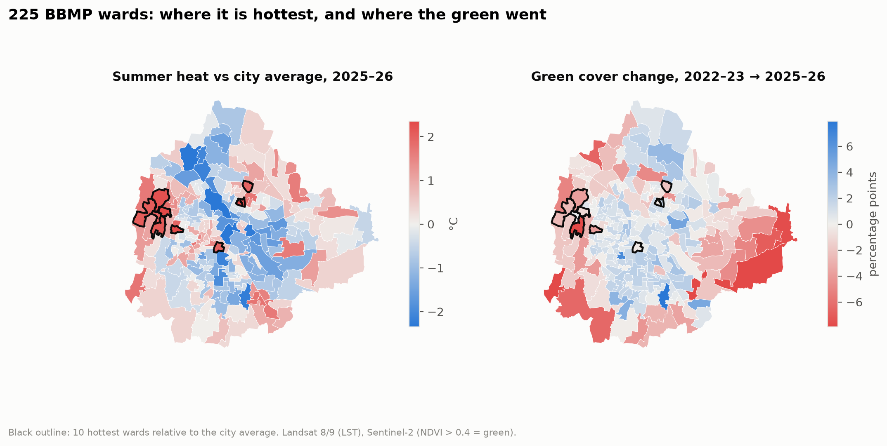

# Concrete Summers: Green Cover Loss and Urban Heat in Bengaluru, 2022–2026

This project has two parts:
- **Part A:** a city-wide study on a 1 km grid.
- **[Part B](#part-b-ward-level-panel-225-bbmp-wards):** a panel of 225 BBMP wards.

*An open, reproducible satellite study of how losing urban greenery is making Bengaluru hotter, with a view to the economics of who pays for it.*

> **Motivation.** I moved to Bengaluru in 2022. Each summer since then has felt harsher than the last, and the city I arrived in was visibly greener than the one I live in now. As a data engineer I wanted to test that feeling against evidence. Is the city actually getting hotter? Is green cover actually disappearing? And can the two be linked in a way that would stand up to scrutiny?


## Key findings

All figures refer to the pre-monsoon summer (March–May) in the **core city**, a 15 km radius around Vidhana Soudha that roughly matches the BBMP area.

| # | Finding | Evidence |
|---|---|---|
| 1 | **Daytime surface temperature rose by 2.7 °C**, from 37.1 °C (2022) to 39.8 °C (2026). The peak was 40.5 °C in the 2024 drought year. | Landsat 8/9, 10–19 cloud-free scenes per summer |
| 2 | **Green cover fell from 30.0 % to 23.7 % of the core city**, a loss of 6.2 percentage points (pp). It dropped to 16.9 % in 2024. | NDVI > 0.4 share |
| 3 | **Green areas are about 2.2 °C cooler** than non-green areas in every year, with a range of 2.0–2.5 °C. | Pixel-level comparison |
| 4 | **Each 10 pp of green cover lost raises local surface temperature by about 0.69 °C** (95 % CI 0.60–0.78). | Two-way fixed-effects panel: 624 cells of ~1 km × 5 years |
| 5 | Cells in the quartile that lost the most green (−13.7 pp) warmed **0.82 °C relative to the city**. Cells that gained green cooled by 0.51 °C. | Long-difference, 2022–23 → 2025–26 |
| 6 | **The heat island is a night-time phenomenon.** The city stays **2.1–2.5 °C warmer than the countryside at night**, every year. By day, the city core is actually *cooler* than the dry pre-monsoon farmland around it. | MODIS Terra/Aqua, 8-day, 1 km |
| 7 | **58 % of neighbourhoods lost more than 2 pp of green cover. Only 5 % gained.** Losses are concentrated on the expanding periphery. | Grid change analysis |

**On finding 1.** Five summers are too few to call +2.7 °C a statistically significant *trend*: the linear slope is +0.59 °C/yr with p = 0.20, and weather (especially the 2024 drought) moves single years a lot. That is why the causal claim (finding 4) rests on a panel design that removes city-wide weather. It does not rest on the raw time series.


## Part B: ward-level panel (225 BBMP wards)

The grid study above uses ~1 km cells. Part B repeats the analysis on the **225 BBMP administrative wards** (2023 delimitation, via OpenCity). Wards are the unit that budgets, councillors and policy work at, and the unit that census data are reported in.

**Panel:** 225 wards × 5 years × 2 dry seasons = **2,250 ward-seasons**.
- **Seasons:** dry winter (January–February) and pre-monsoon summer (March–May). The monsoon months are excluded because cloud blinds Landsat over Bengaluru.
- **Measures:** Landsat land surface temperature (LST) at 60 m, and Sentinel-2 NDVI and green cover at 20 m.
- **Storage:** validated and stored in DuckDB and Parquet. All 8 automated validation checks pass, and every ward-season has full satellite coverage.



**Interactive map:** [`outputs/maps/ward_explorer.html`](outputs/maps/ward_explorer.html). Download it and open it in a browser, or publish it with GitHub Pages. You can switch layers and hover over any ward for its details.

| Model (SE clustered by ward) | Effect | 95 % CI |
|---|---|---|
| **Summer:** 0.1 drop in NDVI → surface temperature | **+1.9 °C** | 1.3 – 2.6 |
| **Summer:** 10 pp of green cover lost → surface temperature | **+1.0 °C** | 0.8 – 1.3 |
| Winter: 0.1 drop in NDVI → surface temperature | +0.24 °C | 0.03 – 0.45 |
| Both seasons, two-way fixed effects: 0.1 drop in NDVI | +0.82 °C | 0.61 – 1.02 |
| Long difference, ward level: 10 pp green lost → relative warming | +0.99 °C | SE 0.20 |

**What the ward panel adds:**

1. **Green cover's cooling value is mostly a summer phenomenon.** Per unit of NDVI, the effect is about eight times larger in summer than in winter. Valuations of urban trees that ignore seasons will be wrong.
2. **The hottest wards form an industrial belt.** Six of the ten hottest wards (2.0–2.6 °C above the city average) sit on the western industrial edge, in the Dasarahalli, Govindaraja Nagar, Yeshvanthapura and Rajarajeshwari Nagar constituencies, around Peenya. All ten have green cover of just 5–18 %.
3. **Green is being lost at the edge, not the centre.** Inside BBMP, ward-average green cover barely moved (21.7 % → 20.4 %). Only 16 % of wards lost more than 2 pp, and 12 % gained. Losses cluster in the eastern and south-western periphery wards. Combined with the Part A map, this suggests most greenery is disappearing on the urban fringe, much of it outside BBMP's boundary. That is a governance question as much as an environmental one.
4. **Density is linked to heat; social group is not (in this data).** Denser wards are hotter (Spearman ρ = 0.19) and far less green (ρ = −0.58). Wards with a higher SC/ST population share are *not* hotter (ρ = 0.06, p = 0.37) and are somewhat greener (ρ = 0.30). With this proxy and these data I find no heat-inequity gap. The proxy is coarse: the population figures are Census-2011-based, and SC/ST share is not income. Income or slum data would be a stronger test.

**Air quality (PM2.5):** the module ([`src/air_quality.py`](src/air_quality.py)) is built and tested but **not yet run**, because the OpenAQ API needs a free key. To enable it:
1. Supply your OpenAQ key **at runtime only**. It is never read from or written to any file:
   - **Option A:** run `python src/air_quality.py` in a terminal and paste the key at the hidden prompt. Press Enter to skip.
   - **Option B:** set it for one command only, with `OPENAQ_API_KEY=<your-key> bash run_all.sh`.
   - **Alternatively,** drop a CPCB export into `data/raw/air_quality.csv`.
2. Re-run the pipeline.

It interpolates station PM2.5 to ward centroids (inverse distance weighting) and reports leave-one-out error and distance to the nearest station for every estimate. PM2.5 enters the models as a **separate outcome and a sensitivity check, not as a control in the heat regression**. It is not a plausible driver of surface temperature, so controlling for it would bias the green-cover estimate ("bad control"). Bengaluru also has roughly a dozen monitors for 225 wards, so the interpolated surface is very smooth.

## Why the design matters (the econometrics)

Comparing green and grey neighbourhoods directly is misleading. Leafy areas such as Cubbon Park or Malleshwaram differ from industrial belts in many ways. So the core estimate uses a **two-way fixed-effects panel**:

```
LST(cell, year) = α(cell) + γ(year) + β · GreenCover(cell, year) + ε
```

- **Cell fixed effects α** absorb everything permanent about a location: elevation, lakes, building density, soil.
- **Year fixed effects γ** absorb everything city-wide in a given year: rainfall, El Niño, the 2024 drought, and the satellite overpass mix.
- **β** is therefore identified only from neighbourhoods whose green cover changed *more or less than the city average*. Standard errors are clustered by cell.

The pooled cross-sectional estimate (−0.47 °C per 10 pp) is *smaller* than the fixed-effects estimate (−0.69). Geography confounds the naive comparison, which is the reason to use fixed effects.

**Robustness.** Peri-urban farmland greens and browns with rainfall, not with development. Restricting the sample to dense urban cells gives the same answer:

| Sample | °C per 10 pp green lost | Cells |
|---|---|---|
| All core cells | +0.69 (SE 0.05) | 624 |
| Cropland < 10 % of cell | +0.65 (SE 0.09) | 454 |
| Built-up > 50 % of cell | +0.71 (SE 0.05) | 461 |

## Data (all free and open, no account needed)

| Dataset | Use | Resolution |
|---|---|---|
| USGS Landsat 8/9 Collection 2 Level-2 | Daytime land surface temperature (LST, band ST_B10) and NDVI | 30 m (thermal 100 m), analysed at 60 m |
| NASA MODIS MOD11A2 / MYD11A2 v6.1 | Day and night LST | 1 km, 8-day |
| ESA WorldCover 2021 | Fixed land-cover mask (built-up, cropland, water) | 10 m |
| Copernicus Sentinel-2 L2A | NDVI and green cover per ward (Part B), SCL cloud mask | 20 m |
| BBMP 225-ward boundaries (2023 delimitation) | Ward unit of analysis, population, SC/ST population | via [OpenCity](https://data.opencity.in) |
| OpenAQ / CPCB (optional) | Station PM2.5 for interpolation | Station points |

All data are accessed through the [Microsoft Planetary Computer](https://planetarycomputer.microsoft.com/) STAC API.

## Reproduce it

```bash
pip install -r requirements.txt
bash run_all.sh        # ~20 minutes on first run (satellite downloads are cached)
```

| File | Role |
|---|---|
| `src/config.py` | Every analytical choice (study area, season, thresholds) in one place |
| `src/composites.py` | Landsat search, cloud masking, scaling to °C, yearly median composites |
| `src/modis.py` | MODIS day/night LST |
| `src/analysis.py` | Yearly metrics, panel regressions, robustness → `outputs/*.csv`, `results.json` |
| `src/figures.py` | Figures → `outputs/figures/` |
| **Part B** | |
| `src/wards.py` | Step 1: KML → validated GeoParquet/GeoJSON. Repairs invalid geometries and reconciles areas. |
| `src/seasonal.py` | Step 2: Landsat LST and Sentinel-2 NDVI per year × season (cached, with retries) |
| `src/air_quality.py` | Step 3: PM2.5 from OpenAQ or CPCB → IDW per ward, with leave-one-out CV (optional) |
| `src/panel.py` | Step 4: zonal statistics → ward panel in DuckDB + Parquet, 8 validation checks |
| `src/ward_models.py` | Step 5a: fixed-effects models, top-10 wards, equity analysis |
| `src/ward_maps.py` | Step 5b: interactive and static ward maps |

Query the panel directly with DuckDB:
```sql
-- duckdb data/uhi.duckdb
SELECT w.ward_name, p.year, p.mean_lst_c, p.green_cover_pct
FROM ward_panel p JOIN wards w USING (ward_id)
WHERE p.season = 'summer' ORDER BY p.mean_lst_c DESC LIMIT 10;
```

## Limitations (read before citing a number)

See [`docs/methodology.md`](docs/methodology.md) for detail. In short:

- **Surface temperature is not air temperature.** LST measures how hot roofs, roads and canopy are, not the air people breathe. It correlates with the heat people feel, but it is not identical to it.
- **NDVI-based green cover mixes permanent loss with seasonal browning.** Two-year averaging, year fixed effects and the cropland-excluded robustness check address this, but they do not eliminate it.
- **Five years is short.** The *relationship* between green cover and heat is well identified. The city-wide *trend* is not yet statistically significant.
- **MODIS orbital drift.** Terra and Aqua overpass times have drifted since 2022. Urban-minus-rural differences are robust to this; absolute night temperatures are less so.
- **Correlation, not experiment.** Fixed effects remove fixed and city-wide confounders. They do not remove time-varying local ones, such as a construction site that both clears trees and adds heat-absorbing materials.

## Where this goes next

The economic questions this raises are in [`docs/economics_extension.md`](docs/economics_extension.md):

- What does a degree of urban heat cost in lost labour productivity, electricity demand and health?
- Who bears that cost?
- What is the shadow price of a tree in Bengaluru?

---
*Author: [Your name], Senior Data Engineer. Built with Python (xarray, stackstac, geopandas, statsmodels, DuckDB, Plotly).*

*Ward boundaries: BBMP via OpenCity (data.opencity.in). Check that dataset's licence and attribution terms before redistributing.*
